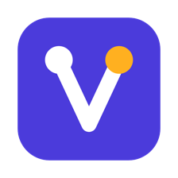
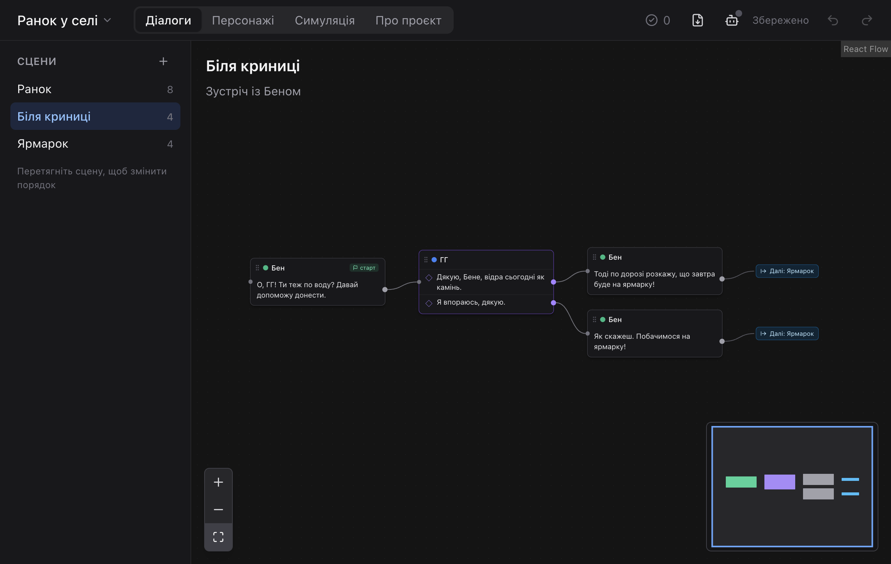
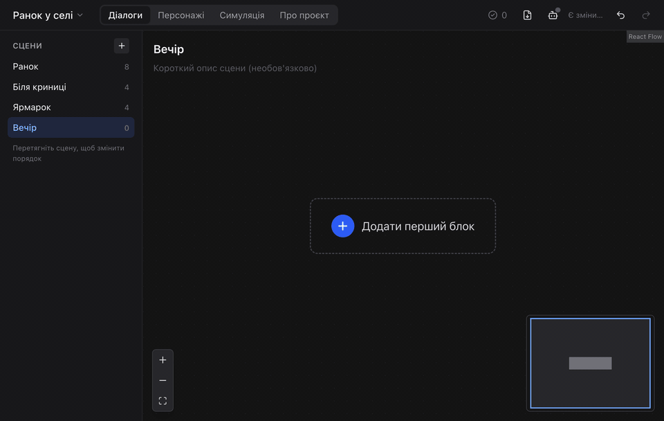
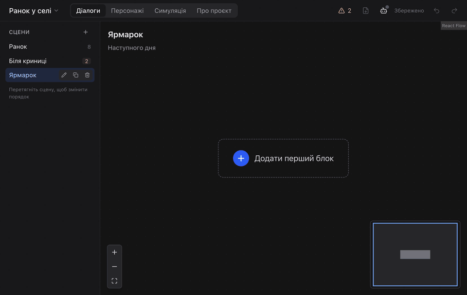
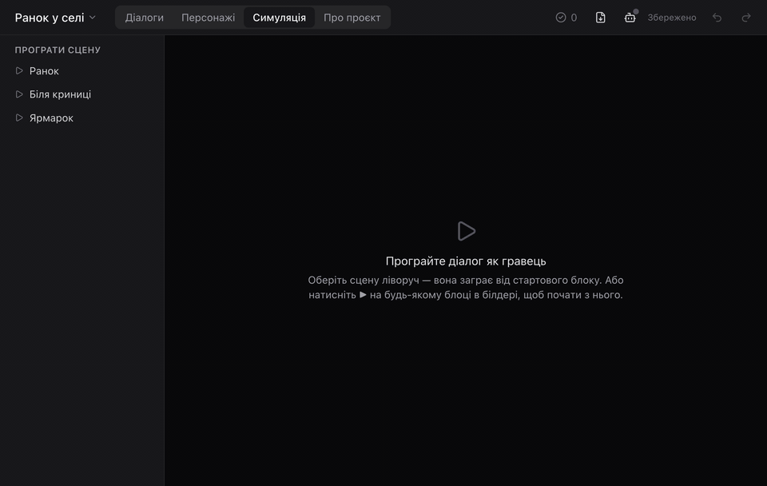
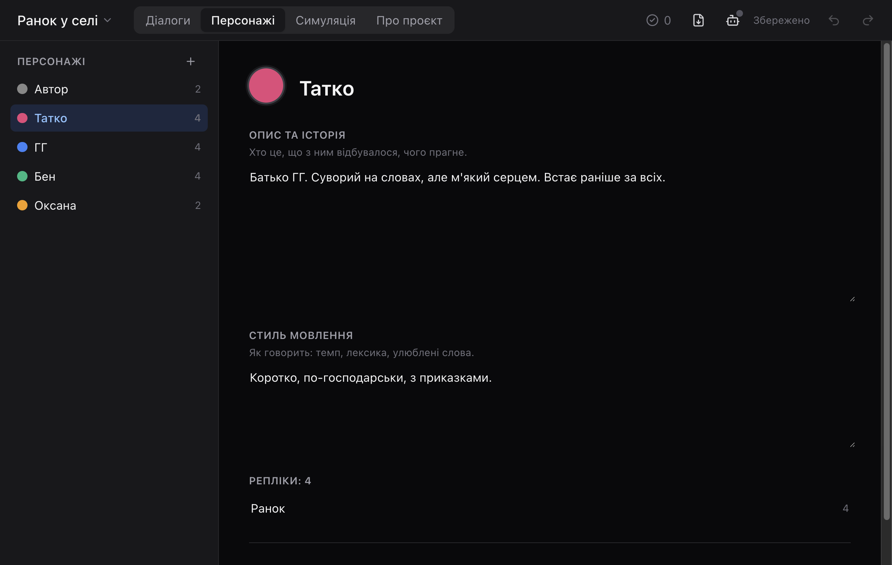
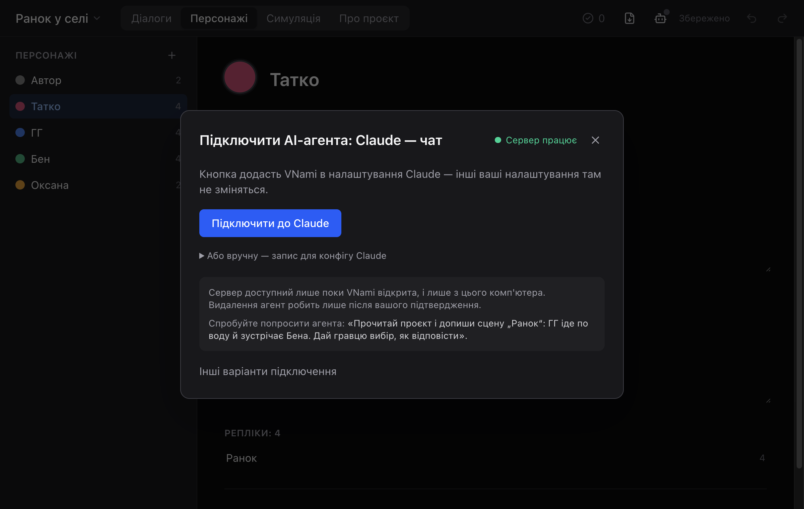

<div align="center">



# VNami

**A visual editor for branching visual-novel dialogue — with an AI co-writer built in.**

Draw who says what and where the player chooses. Let Claude or any other AI agent write alongside you.
Play the result as a chat. Export it as JSON for your engine.

[](https://github.com/ValdekBro/vn-dialogs-builder/releases/latest)


**[Website](https://valdekbro.github.io/vn-dialogs-builder/)** · **[Download](https://github.com/ValdekBro/vn-dialogs-builder/releases/latest)** · **[What's new](CHANGELOG.md)**



</div>

## What it does

### Build dialogue as a map, not a document

Every block is one character's lines. A block with several lines is a choice — each option gets its own arrow. Branches can merge again, loop back, or jump to another scene. Anything unfinished is marked red, so you always see what is left.



### Write together with an AI agent

VNami has a built-in [MCP](https://modelcontextprotocol.io) server. Connect Claude (the desktop app or Claude Code), Cursor or another agent, and ask it to write a scene: it reads your characters and lore, and its blocks appear on the canvas as it works. Everything it does can be undone, and it can only delete things after you approve.



### Play it the way a player will

The Simulation section (**Симуляція**) plays a scene as a chat: lines appear one by one, choices become buttons, jumps carry on into the next scene. If a branch breaks, it stops and shows you where.



### And the rest

- **Projects and scenes** — many projects, each with characters, lore and any number of scenes. Autosave every second.
- **Characters** — colour, backstory and speech style; the AI agent uses them too.
- **Undo everything** — one shared history for you and the agent.
- **Export and import** — the export button in the top bar and **Імпорт з JSON** on the Projects screen; a versioned JSON format ([spec](SCHEMA.md#8-export-format)) to take the dialogue into your engine.
- **Local and private** — no account, no cloud. Your projects stay on your computer.

<table>
  <tr>
    <td width="50%"></td>
    <td width="50%"></td>
  </tr>
  <tr>
    <td align="center"><sub>Characters with backstory and speech style</sub></td>
    <td align="center"><sub>Connecting Claude takes one button</sub></td>
  </tr>
</table>

## Download

Get the latest version from **[Releases](https://github.com/ValdekBro/vn-dialogs-builder/releases/latest)**.

| System | File | Notes |
|---|---|---|
| **Windows** 10/11 | `VNami-Setup-X.Y.Z.exe` | Updates itself: when a new version is out, press **Оновити** (Update) in the banner. |
| **macOS**, Apple Silicon (M1 and newer) | `VNami-X.Y.Z-mac-arm64.dmg` | Open the `.dmg` and drag VNami into Applications. |
| **macOS**, Intel | `VNami-X.Y.Z-mac-x64.dmg` | Not sure which Mac you have? Apple menu → About This Mac. |

<details>
<summary><b>macOS says the app "cannot be opened"</b></summary>

VNami is not signed with a paid Apple developer certificate yet, so the first launch needs one extra step:
open the app once, then go to **System Settings → Privacy & Security** and press **Open Anyway**. After that it opens normally.
New versions on Mac are installed the same way: the banner's **Завантажити** (Download) button opens the release page; drag the new version over the old one. Your projects stay.
</details>

<details>
<summary><b>Where are my projects stored?</b></summary>

Each project is a JSON file in the app's data folder:
`~/Library/Application Support/VNami/projects` on macOS, `%APPDATA%\VNami\projects` on Windows.
There is no "Save" button — changes are saved every second.
</details>

## Connect an AI agent

1. Open VNami and press the robot button in the top bar (**Підключити AI-агента** — Connect an AI agent).
2. Pick your AI: **Claude** (chat app or Claude Code), **Cursor**, or another MCP agent.
3. Follow the one step shown for it — for the Claude app it is the **Підключити до Claude** (Connect to Claude) button; for Claude Code, a prompt to paste.
4. Ask something like: *"Read the project and write the «Ярмарок» scene: ГГ buys bagels and gives the player a choice."*

The server is available only on your computer and only while VNami is open. Details: [MCP.md](MCP.md).

## For developers

VNami is an Electron app written in TypeScript: React and React Flow for the canvas, a pure TypeScript core for the model, and the MCP server running in the main process next to it.

```bash
pnpm install        # Node 22+, pnpm 10 (corepack enable)
pnpm dev            # run the app with hot reload
```

| Command | What it does |
|---|---|
| `pnpm test` | Unit and MCP integration tests (Vitest, seconds) |
| `pnpm typecheck` | TypeScript for every package |
| `pnpm e2e` | End-to-end tests on the real app (Playwright); `pnpm e2e -g "E5"` for one scenario |
| `pnpm --filter @vn/desktop showcase` | Re-record the README screenshots and GIFs (`docs/media`) and the website videos (`site/media`); needs `ffmpeg` |
| `pnpm --filter @vn/desktop icons` | Rebuild the app icons from `apps/desktop/build/icon*.svg` |
| `pnpm release X.Y.Z` | Tag a release; GitHub Actions builds and publishes it (needs a `CHANGELOG.md` entry) |

```
packages/core     the model: schema, commands, undo/redo, issues, export — no UI, no Electron
apps/desktop      the Electron app
  src/main        project storage, autosave, MCP server, updates
  src/renderer    the UI (React)
  e2e/            Playwright scenarios
docs/media        README screenshots and GIFs
site/             the website (GitHub Pages): plain HTML, CSS and JS, no build step
```

**Docs:** [OVERVIEW](OVERVIEW.md) — the product and its scope ·
[FLOWS](FLOWS.md) — how every screen behaves ·
[ARCHITECTURE](ARCHITECTURE.md) — stack and structure ·
[SCHEMA](SCHEMA.md) — project and export formats ·
[MCP](MCP.md) — the agent tools ·
[TESTING](TESTING.md) — test levels and E2E scenarios ·
[CHANGELOG](CHANGELOG.md)

Code, comments and docs are in English; the interface and sample dialogue are in Ukrainian.
